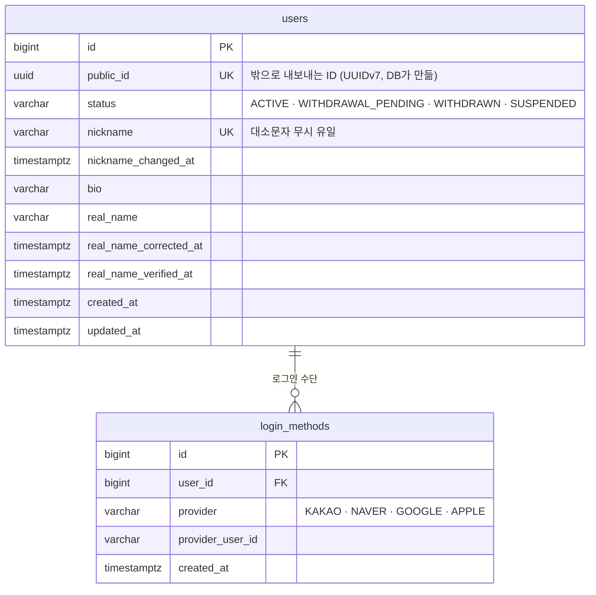

# DB 설계

> 테이블을 만들거나 바꾸는 PR은 이 문서를 먼저 고치고, 같은 PR에서 Flyway SQL을 더한다.
> 공통 약속(ID · 시간 · Flyway)은 [conventions.md](conventions.md).

## 한눈에

| 표 | 한 행은 | 마이그레이션 |
|---|---|---|
| `users` | 서비스 회원 한 명 | V1 |
| `login_methods` | 회원이 쓰는 소셜 계정 하나 | V1 |

---

## users — 회원

공개 영역 · 동아리 활동의 주체. **행은 지우지 않는다.** 서비스를 탈퇴하면 개인 정보를 비우고 글 · 댓글의 작성자로만 남긴다.

| 열 | 타입 | 필수 | 규칙 · 뜻 |
|---|---|---|---|
| `id` | `bigint` 자동 증가 | ✓ | DB 안에서만 쓰는 번호. API에 내보내지 않는다 |
| `public_id` | `uuid` | ✓ | 밖으로 내보내는 ID. UUIDv7(시간순). 유일. **DB가 만든다** (`DEFAULT uuidv7()`) |
| `status` | `varchar(20)` | ✓ | 아래 상태 표 |
| `nickname` | `varchar(12)` | 탈퇴 완료만 빈칸 | 전역 닉네임. 2~12자, **대소문자 무시 유일**, NFC 정규화된 값만 |
| `nickname_changed_at` | `timestamptz` | | 마지막 변경 시각. 30일에 한 번만 바꾸는 규칙에 쓴다 |
| `bio` | `varchar(30)` | | 한 줄 소개 |
| `real_name` | `varchar(20)` | | 실명. 가입 때는 선택, 동아리 가입 · 행사 신청 때 필수. 2~20자, NFC 정규화된 값만 |
| `real_name_corrected_at` | `timestamptz` | | 실명을 고친 시각. 값이 있으면 다시 고칠 수 없다 (1회 수정) |
| `real_name_verified_at` | `timestamptz` | | 본인인증 시각. 본인인증 기능 전까지 비어 있다 |
| `created_at` · `updated_at` | `timestamptz` | ✓ | UTC |

상태

| 상태 | 뜻 | 닉네임 · 개인 정보 |
|---|---|---|
| `ACTIVE` | 활동 중 | 있음 |
| `WITHDRAWAL_PENDING` | 탈퇴 신청 뒤 30일. 로그인하면 복구 가능 | 남아 있음 → 그 닉네임은 다른 사람이 못 씀 |
| `WITHDRAWN` | 탈퇴 완료 | 닉네임 · 소개 · 실명을 비움 (DB가 강제). 로그인 수단은 탈퇴 처리에서 지움 (아래 탈퇴 방침) |
| `SUSPENDED` | 서비스 관리자가 이용 정지 | 있음 |

DB가 직접 막는 것

| 제약 | 막는 것 |
|---|---|
| `users_public_id_key` | 공개 ID 중복 |
| `users_public_id_v7_check` | UUIDv7이 아닌 공개 ID (손으로 넣은 v4 등) |
| `users_nickname_lower_key` (`lower(nickname COLLATE "C")` 유일 인덱스) | `Baggy`와 `baggy`처럼 대소문자만 다른 닉네임. `"C"`라서 OS 로케일(로컬 musl · 운영 glibc)과 상관없이 같은 결과이고, OS를 올려도 인덱스를 다시 만들 일이 없다. ASCII만 접으므로 닉네임 문자 규칙(한글 · 영문 · 숫자)과 맞는다 |
| `users_status_check` | 위 4개 말고 다른 상태 값 |
| `users_nickname_required_check` | 탈퇴 완료가 아닌데 닉네임이 빈 회원 |
| `users_withdrawn_anonymized_check` | 탈퇴 완료인데 닉네임 · 소개 · 실명이 남은 회원 |
| `users_nickname_length_check` · `users_real_name_length_check` | 최소 길이 미달 (최대 길이는 `varchar(n)`이 막음) |
| `users_nickname_nfc_check` · `users_real_name_nfc_check` | NFC가 아닌 값. 맥 · 복사 붙여넣기에서 들어오는 NFD(자모 분리) "남진"은 화면에선 같아 보여도 다른 값이라 사칭 닉네임이 된다. 앱은 검사 전에 NFC로 바꾼다 |

앱에서만 검사하는 것 (바뀔 수 있는 정책이라 DB에 두지 않음): 닉네임 문자 종류(한글 · 영문 · 숫자) · 금지어 · 30일 변경 제한 · 실명 문자 종류

`updated_at`은 Hibernate가 갱신한다. SQL로 직접 고치면 함께 고친다

## login_methods — 로그인 수단

회원 1 : N. 회원은 **(제공자, 제공자 ID)** 로만 찾는다. 이메일은 회원 식별자가 아니라서 저장하지 않는다. 같은 이메일을 가진 다른 제공자 계정을 자동으로 합치지 않는다.

| 열 | 타입 | 필수 | 규칙 · 뜻 |
|---|---|---|---|
| `id` | `bigint` 자동 증가 | ✓ | 내부 번호 |
| `user_id` | `bigint` → `users.id` | ✓ | 이 로그인 수단의 회원 |
| `provider` | `varchar(10)` | ✓ | `KAKAO` · `NAVER` · `GOOGLE` · `APPLE` |
| `provider_user_id` | `varchar(255)` | ✓ | 제공자가 주는 회원 번호 (카카오 회원번호 · 구글 · 애플 `sub`) |
| `created_at` | `timestamptz` | ✓ | 연결한 시각 |

| 제약 · 인덱스 | 뜻 |
|---|---|
| `login_methods_provider_user_key` (`provider`, `provider_user_id`) 유일 | 같은 소셜 계정이 두 회원에 붙지 않는다 |
| `login_methods_user_id_fkey` | 없는 회원에게 붙지 않는다 |
| `login_methods_user_id_idx` | 회원의 로그인 수단 목록 조회 (PostgreSQL은 외래 키 인덱스를 자동으로 만들지 않음) |
| `login_methods_provider_check` | 4개 말고 다른 제공자 |

## 가입 · 탈퇴 방침 (API 만들 때 지킬 것)

| 방침 | 이유 |
|---|---|
| 가입은 `users` · `login_methods` INSERT를 **한 트랜잭션**에서. 시작할 때 (제공자, 제공자 ID)로 먼저 찾는다 | 가입 화면을 두 번 제출하면 로그인 수단 없는 회원이 닉네임만 잡고 남는다. 회원 행은 지우지 않으니 치울 길이 없다 |
| 유일 제약 위반은 트랜잭션 **밖**에서 잡아 에러 `code`로 바꾼다 (제약 이름 → `code` 표는 한 곳에) | PostgreSQL은 위반 뒤 그 트랜잭션을 못 쓰게 만들고, Hibernate도 예외가 난 세션을 버리라고 한다 |
| 탈퇴 완료 = 같은 트랜잭션에서 회원 익명화 + `login_methods` 행 삭제, 그리고 제공자 연결 끊기 · 토큰 회수 | 제공자 ID가 남으면 익명 글이 다시 사람과 이어지고, 같은 소셜 계정으로 새로 가입할 수 없다. 애플은 계정 삭제 때 토큰 회수를 요구한다 (App Store 심사 기준 5.1.1(v)) |

## 아직 정하지 않은 것

| 항목 | 정할 때 |
|---|---|
| 한 회원이 같은 제공자 계정을 두 개 연결할 수 있는가 (`user_id`, `provider` 유일 여부) | 로그인 수단 연결 기능 |
| 애플 토큰 회수를 위해 제공자 Refresh 토큰을 저장할지 | 로그인 API |
| 프로필 사진 열 | 사진 업로드 설계 |
| 약관 동의 기록 | 가입 API |
| Refresh 토큰 표 | 로그인 API |
