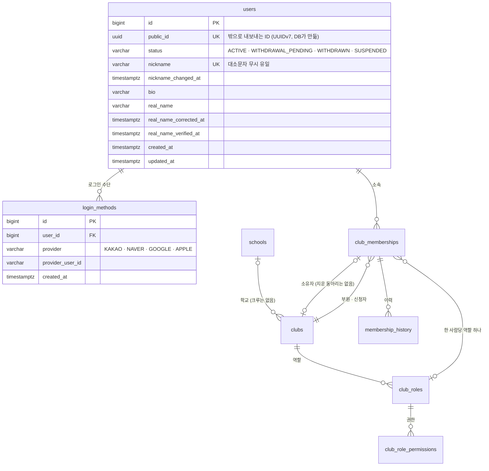

# DB 설계

> 테이블을 만들거나 바꾸는 PR은 이 문서를 먼저 고치고, 같은 PR에서 Flyway SQL을 더한다.
> 공통 약속(ID · 시간 · Flyway)은 [conventions.md](conventions.md).

## 한눈에



| 표 | 한 행은 | 마이그레이션 |
|---|---|---|
| `users` | 서비스 회원 한 명 | V1 |
| `login_methods` | 회원이 쓰는 소셜 계정 하나 | V1 |
| `schools` | 학교 하나 | V2 |
| `clubs` | 동아리 · 크루 하나 | V2 |
| `club_roles` | 동아리의 역할 하나 | V2 |
| `club_role_permissions` | 역할이 가진 권한 하나 | V2 |
| `club_memberships` | 회원 × 동아리 한 쌍 | V2 |
| `membership_history` | 멤버십에 일어난 일 한 번 | V2 |

ERD에는 V1 열만 그린다. V2 열은 아래 표가 기준이다

---

## users — 회원

공개 영역 · 동아리 활동의 주체. **행은 지우지 않는다.** 서비스를 탈퇴하면 개인 정보를 비우고 글 · 댓글의 작성자로만 남긴다.

| 열 | 타입 | 필수 | 규칙 · 뜻 |
|---|---|---|---|
| `id` | `bigint` 자동 증가 | ✓ | DB 안에서만 쓰는 번호. API에 내보내지 않는다 |
| `public_id` | `uuid` | ✓ | 밖으로 내보내는 ID. UUIDv7(시간순). 유일. **DB가 만든다** (`DEFAULT uuidv7()`) |
| `status` | `varchar(20)` | ✓ | 아래 상태 표 |
| `nickname` | `varchar(12)` | 탈퇴 완료만 빈칸 | 전역 닉네임. 2~12자, **대소문자 무시 유일**, NFC 정규화된 값만 |
| `nickname_changed_at` | `timestamptz` | | 마지막 변경 시각. 30일에 한 번만 바꾸는 규칙에 쓴다 |
| `bio` | `varchar(30)` | | 한 줄 소개 |
| `real_name` | `varchar(20)` | | 실명. 가입 때는 선택, 동아리 가입 · 행사 신청 때 필수. 2~20자, NFC 정규화된 값만 |
| `real_name_corrected_at` | `timestamptz` | | 실명을 고친 시각. 값이 있으면 다시 고칠 수 없다 (1회 수정) |
| `real_name_verified_at` | `timestamptz` | | 본인인증 시각. 본인인증 기능 전까지 비어 있다 |
| `created_at` · `updated_at` | `timestamptz` | ✓ | UTC |

상태

| 상태 | 뜻 | 닉네임 · 개인 정보 |
|---|---|---|
| `ACTIVE` | 활동 중 | 있음 |
| `WITHDRAWAL_PENDING` | 탈퇴 신청 뒤 30일. 로그인하면 복구 가능 | 남아 있음 → 그 닉네임은 다른 사람이 못 씀 |
| `WITHDRAWN` | 탈퇴 완료 | 닉네임 · 소개 · 실명을 비움 (DB가 강제). 로그인 수단은 탈퇴 처리에서 지움 (아래 탈퇴 방침) |
| `SUSPENDED` | 서비스 관리자가 이용 정지 | 있음 |

DB가 직접 막는 것

| 제약 | 막는 것 |
|---|---|
| `users_public_id_key` | 공개 ID 중복 |
| `users_public_id_v7_check` | UUIDv7이 아닌 공개 ID (손으로 넣은 v4 등) |
| `users_nickname_lower_key` (`lower(nickname COLLATE "C")` 유일 인덱스) | `Baggy`와 `baggy`처럼 대소문자만 다른 닉네임. `"C"`라서 OS 로케일(로컬 musl · 운영 glibc)과 상관없이 같은 결과이고, OS를 올려도 인덱스를 다시 만들 일이 없다. ASCII만 접으므로 닉네임 문자 규칙(한글 · 영문 · 숫자)과 맞는다 |
| `users_status_check` | 위 4개 말고 다른 상태 값 |
| `users_nickname_required_check` | 탈퇴 완료가 아닌데 닉네임이 빈 회원 |
| `users_withdrawn_anonymized_check` | 탈퇴 완료인데 닉네임 · 소개 · 실명이 남은 회원 |
| `users_nickname_length_check` · `users_real_name_length_check` | 최소 길이 미달 (최대 길이는 `varchar(n)`이 막음) |
| `users_nickname_nfc_check` · `users_real_name_nfc_check` | NFC가 아닌 값. 맥 · 복사 붙여넣기에서 들어오는 NFD(자모 분리) "남진"은 화면에선 같아 보여도 다른 값이라 사칭 닉네임이 된다. 앱은 검사 전에 NFC로 바꾼다 |

앱에서만 검사하는 것 (바뀔 수 있는 정책이라 DB에 두지 않음): 닉네임 문자 종류(한글 · 영문 · 숫자) · 금지어 · 30일 변경 제한 · 실명 문자 종류

`updated_at`은 Hibernate가 갱신한다. SQL로 직접 고치면 함께 고친다

## login_methods — 로그인 수단

회원 1 : N. 회원은 **(제공자, 제공자 ID)** 로만 찾는다. 이메일은 회원 식별자가 아니라서 저장하지 않는다. 같은 이메일을 가진 다른 제공자 계정을 자동으로 합치지 않는다.

| 열 | 타입 | 필수 | 규칙 · 뜻 |
|---|---|---|---|
| `id` | `bigint` 자동 증가 | ✓ | 내부 번호 |
| `user_id` | `bigint` → `users.id` | ✓ | 이 로그인 수단의 회원 |
| `provider` | `varchar(10)` | ✓ | `KAKAO` · `NAVER` · `GOOGLE` · `APPLE` |
| `provider_user_id` | `varchar(255)` | ✓ | 제공자가 주는 회원 번호 (카카오 회원번호 · 구글 · 애플 `sub`) |
| `created_at` | `timestamptz` | ✓ | 연결한 시각 |

| 제약 · 인덱스 | 뜻 |
|---|---|
| `login_methods_provider_user_key` (`provider`, `provider_user_id`) 유일 | 같은 소셜 계정이 두 회원에 붙지 않는다 |
| `login_methods_user_id_fkey` | 없는 회원에게 붙지 않는다 |
| `login_methods_user_id_idx` | 회원의 로그인 수단 목록 조회 (PostgreSQL은 외래 키 인덱스를 자동으로 만들지 않음) |
| `login_methods_provider_check` | 4개 말고 다른 제공자 |

## 가입 · 탈퇴 방침 (API 만들 때 지킬 것)

| 방침 | 이유 |
|---|---|
| 가입은 `users` · `login_methods` INSERT를 **한 트랜잭션**에서. 시작할 때 (제공자, 제공자 ID)로 먼저 찾는다 | 가입 화면을 두 번 제출하면 로그인 수단 없는 회원이 닉네임만 잡고 남는다. 회원 행은 지우지 않으니 치울 길이 없다 |
| 유일 제약 위반은 트랜잭션 **밖**에서 잡아 에러 `code`로 바꾼다 (제약 이름 → `code` 표는 한 곳에) | PostgreSQL은 위반 뒤 그 트랜잭션을 못 쓰게 만들고, Hibernate도 예외가 난 세션을 버리라고 한다 |
| 탈퇴 완료 = 같은 트랜잭션에서 회원 익명화 + `login_methods` 행 삭제, 그리고 제공자 연결 끊기 · 토큰 회수 | 제공자 ID가 남으면 익명 글이 다시 사람과 이어지고, 같은 소셜 계정으로 새로 가입할 수 없다. 애플은 계정 삭제 때 토큰 회수를 요구한다 (App Store 심사 기준 5.1.1(v)) |

---

# 동아리 · 멤버십 (V2, 설계)

> 근거: ADR-001 신원 · ADR-002 역할 · 권한, 기능 FN-2 · 22 · 63 · 68. 마이그레이션 `V2__create_clubs_and_memberships.sql`.
> "동아리"는 대학 동아리와 크루를 함께 부르는 말이다 (`clubs.type`).

## 동아리 간 격리 — 복합 외래 키

동아리 안에 사는 표는 모두 `club_id`를 갖는다. 동아리 안의 다른 행을 가리킬 때는 **`club_id`까지 함께** 가리킨다.

```sql
-- 부원의 역할은 반드시 같은 동아리의 역할이다
FOREIGN KEY (club_id, role_id) REFERENCES club_roles (club_id, id)
```

| 방식 | A 동아리 부원에게 B 동아리 역할을 붙이는 버그 |
|---|---|
| `role_id`만 참조 | 저장된다. 서비스 코드가 빠뜨리면 B 동아리 권한이 샌다 |
| `(club_id, role_id)` 참조 | DB가 INSERT를 거부한다 |

- 참조받는 표는 `(club_id, id)` 유일 제약을 따로 둔다 (`id`만으로도 유일하지만 외래 키 대상이 되려면 그 열 묶음의 유일 제약이 필요)
- 앞으로 만들 표(공간 · 예약 · 게시판)도 같다. 예: `(club_id, resource_id) → resources (club_id, id)`
- 예외: 동아리 안의 두 행을 잇지 않는 표(`club_role_permissions`)는 부모 하나만 가리키면 된다
- 복합 외래 키는 **한 행 안의** `club_id`끼리 맞는지만 본다. 요청 경로의 동아리와 대상 행의 동아리가 같은지는 앱이 지킨다
  - 동아리 안 표의 리포지토리는 `findByClubIdAndPublicId(clubId, publicId)`처럼 **동아리를 함께 받는 조회만** 둔다. `findByPublicId` · `findById`를 동아리 서비스에서 부르면 ArchUnit이 실패시킨다
  - 막는 것: A 동아리 관리자가 `PUT /clubs/{A}/roles/{B의 역할}/…`로 B 동아리 역할을 바꾸는 일. 통합 테스트: 다른 동아리의 ID를 넣으면 404
- 전제: 공간 · 글은 한 동아리 소속. 파일럿에서 여러 동아리가 같은 연습실을 함께 쓰자는 요구가 나오면 다시 본다 🔍

## 권한

권한은 **역할**에 붙고, 부원은 역할 하나를 갖는다. 권한 이름은 코드 · DB 공통 값이다.

| 값 | 화면 이름 | 포함하는 일 | 기본 관리자 | 기본 멤버 | 기본 뷰어 |
|---|---|---|---|---|---|
| (없음) | 보기 | 동아리 내부 정보 보기. 활동 멤버십이면 누구나 | ✓ | ✓ | ✓ |
| `POST_WRITE` | 글쓰기 | 게시판 글 · 댓글 | ✓ | ✓ | |
| `RESERVATION_CREATE` | 예약하기 | 연습 공간 · 물품 예약 | ✓ | ✓ | |
| `NOTICE_MANAGE` | 공지 작성 | 공지 등록 · 고정 · 다른 사람 글 · 댓글 삭제 | ✓ | | |
| `RESERVATION_APPROVE` | 예약 승인 | 승인 · 거절 · 시간 차단 · 담당자 변경 · 반납 확인 | ✓ | | |
| `RESOURCE_MANAGE` | 공간 · 물품 관리 | 공간 · 물품 등록 · 수정 · 사용 규칙 | ✓ | | |
| `MEMBER_MANAGE` | 부원 · 역할 관리 | 가입 승인 · 거절 · 강퇴 · 역할 부여 · 역할 만들기 · 가입 기본 역할 · 가입 방식 · 신청자 · 부원 실명 보기 | ✓ | | |
| `CLUB_MANAGE` | 동아리 정보 · 행사 | 소개 · 사진 · 모집 여부 수정 · 동아리 명의 행사 · 신청자 명단 · 실명 보기 | ✓ | | |

- 소유자는 역할과 상관없이 모든 권한을 갖는다. 소유자만: 동아리 삭제 · 소유자 양도
- 기본 역할 이름(관리자 · 멤버 · 뷰어)과 권한은 동아리가 바꿀 수 있다. 위 표는 만들 때의 값이다
- 자기보다 넓은 권한은 줄 수 없고, 본인 역할은 본인이 못 바꾼다 (앱에서 검사, FN-2)
- 권한 검사는 서비스 메서드의 `@RequiresClubPermission(…)` 하나로 하고, 이 애너테이션이 없는 동아리 서비스 메서드는 ArchUnit 테스트가 CI에서 실패시킨다

## schools — 학교

대학 동아리가 고르는 학교 목록. 재학 인증이 아니라 동아리에 붙는 이름표이고, 같은 학교 안 동아리 이름 중복을 막는 기준이다.

| 열 | 타입 | 필수 | 규칙 · 뜻 |
|---|---|---|---|
| `id` | `bigint` 자동 증가 | ✓ | 내부 번호 |
| `public_id` | `uuid` | ✓ | 밖으로 내보내는 ID. `DEFAULT uuidv7()` |
| `name` | `varchar(50)` | ✓ | 정식 이름 (예: 서울대학교). 유일 |
| `created_at` | `timestamptz` | ✓ | |

| 제약 · 인덱스 | 뜻 |
|---|---|
| `schools_public_id_key` · `schools_public_id_v7_check` | 공개 ID 중복 · v7 아님 |
| `schools_name_key` | 같은 학교가 두 번 들어가지 않는다 |

## clubs — 동아리

**행은 지우지 않는다.** 삭제하면 `deleted_at`을 채운다. 동아리 명의 행사 · 글이 이 행을 계속 가리키고, 서비스 관리자가 신고 · 복구를 확인할 수 있어야 한다.

| 열 | 타입 | 필수 | 규칙 · 뜻 |
|---|---|---|---|
| `id` | `bigint` 자동 증가 | ✓ | 내부 번호 |
| `public_id` | `uuid` | ✓ | 공유 링크 · URL에 쓰는 ID. `DEFAULT uuidv7()` |
| `type` | `varchar(10)` | ✓ | `CLUB`(대학 동아리) · `CREW`(크루 · 학교 밖 모임) |
| `name` | `varchar(30)` | ✓ | 2~30자, NFC 정규화된 값만 |
| `school_id` | `bigint` → `schools.id` | 동아리만 | `CLUB`이면 필수, `CREW`면 빈칸 |
| `region` | `varchar(20)` | ✓ | 지역. 값 목록은 열린 질문 |
| `intro` | `varchar(500)` | | 소개 |
| `recruiting` | `boolean` | ✓ | 모집 여부. 기본 `false`. `true`일 때만 가입 신청 버튼이 보인다 |
| `join_policy` | `varchar(10)` | ✓ | `APPROVAL`(운영진 승인, 기본) · `AUTO`(바로 가입) |
| `default_join_role_id` | `bigint` | 생성 뒤 ✓ | 승인될 때 받는 역할. `(id, default_join_role_id) → club_roles (club_id, id)` |
| `owner_user_id` | `bigint` | 지우지 않은 동아리만 | 소유자. 동아리를 지우면 비운다 (원래 소유자는 이력에) |
| `owner_status` | `varchar(10)` | 지우지 않은 동아리만 | `ACTIVE`만 (CHECK). 소유자 외래 키에 상태까지 넣으려고 두는 열. 지우면 함께 비운다 |
| `deleted_at` | `timestamptz` | | 삭제 시각. 채워지면 찾기 · 미리보기 · 링크에서 사라진다 |
| `created_at` · `updated_at` | `timestamptz` | ✓ | |

| 제약 · 인덱스 | 막는 것 |
|---|---|
| `clubs_public_id_key` · `clubs_public_id_v7_check` | 공개 ID 중복 · v7 아님 |
| `clubs_type_check` · `clubs_join_policy_check` | 정해진 값 말고 다른 값 |
| `clubs_school_by_type_check` (`(type = 'CLUB') = (school_id IS NOT NULL)`) | 학교 없는 대학 동아리 · 학교 달린 크루 |
| `clubs_school_name_key` (`school_id`, `lower(name COLLATE "C")`) 부분 유일 인덱스, `WHERE deleted_at IS NULL` | 같은 학교에 같은 이름 동아리 (FN-2). 크루는 `school_id`가 비어 있어 걸리지 않는다. 지운 동아리 이름은 다시 쓸 수 있다 |
| `clubs_name_length_check` · `clubs_name_nfc_check` | 최소 길이 미달 · NFD 이름 |
| `clubs_owner_membership_fkey` (`id`, `owner_user_id`, `owner_status`) → `club_memberships (club_id, user_id, status)` **DEFERRABLE INITIALLY DEFERRED** | 소유자가 그 동아리의 **활동** 멤버십 없이 있는 상태 (ADR-002 "소유자 1명"). 소유자 멤버십을 `INACTIVE`로 바꾸는 UPDATE도 커밋 때 거부된다 — 탈퇴 · 강퇴 · 직접 SQL 어느 길로든. 소유자가 나가려면 양도가 먼저다 |
| `clubs_owner_status_check` | `owner_status`가 `ACTIVE`가 아닌 값 |
| `clubs_owner_by_deleted_check` (`(deleted_at IS NULL) = (owner_user_id IS NOT NULL AND owner_status IS NOT NULL)`) | 소유자 없는 살아 있는 동아리 · 지운 뒤에도 소유자가 묶여 탈퇴를 못 하는 사람 (외래 키는 빈 값이 있으면 검사하지 않는다) |
| `clubs_default_join_role_fkey` **DEFERRABLE INITIALLY DEFERRED** | 다른 동아리 역할을 가입 기본 역할로 쓰기 · 가입 기본 역할 삭제 |
| `clubs_school_id_idx` | 학교 필터 (FN-22) |

**동아리 만들기는 한 트랜잭션** (서로 가리키는 외래 키라 순서가 정해져 있다)

1. `clubs` INSERT (`owner_user_id` = 만드는 사람, `default_join_role_id`는 비워 둠)
2. `club_roles` 기본 3개 + `club_role_permissions` INSERT
3. 소유자 `club_memberships` INSERT (`ACTIVE`, 관리자 역할)
4. `clubs.default_join_role_id` = 멤버 역할로 UPDATE
5. `em.flush()` 후 `SET CONSTRAINTS clubs_owner_membership_fkey, clubs_default_join_role_fkey IMMEDIATE` — 미뤄 둔 검사를 **메서드 안에서** 돌린다. 어긋나면 여기서 제약 이름과 함께 터져 에러 `code`로 바꿀 수 있다 (COMMIT 때 터지면 Spring이 다른 예외로 감싸 500이 된다). 검사한 뒤 같은 두 제약을 `DEFERRED`로 되돌린다 — `IMMEDIATE`는 트랜잭션 끝까지 남아서, 되돌리지 않으면 같은 트랜잭션의 다음 동아리 만들기 1단계가 거부된다 (V2 테스트에서 확인)
6. COMMIT

- `default_join_role_id`는 1~4 사이에만 비어 있다. PostgreSQL의 NOT NULL은 미룰 수 없고, 빈 값은 외래 키 검사를 그냥 통과한다 → 4단계를 빠뜨리지 않는지는 통합 테스트로 확인한다
- 지연 외래 키에 닿는 **모든 쓰기**는 같은 5단계(flush → `SET CONSTRAINTS … IMMEDIATE`)로 끝낸다: 멤버십 상태 변경(승인 · 나가기 · 강퇴 · 서비스 탈퇴) · 소유자 양도 · 역할 삭제 · 동아리 삭제. 앱이 먼저 "소유자면 거부"를 검사하고, 외래 키는 마지막 방어선이다
- 소유자 양도: 받는 사람은 그 동아리 `ACTIVE` 멤버십 + `users.status = ACTIVE`만
- 동아리 삭제: 같은 트랜잭션에서 `deleted_at` 채우기 + `owner_user_id` · `owner_status` 비우기 + 이력
- 지운 동아리 복구: 서비스 관리자만. 그 사이 같은 학교에 같은 이름 동아리가 생겼으면 이름을 바꾼 뒤 복구한다

## club_roles — 역할

| 열 | 타입 | 필수 | 규칙 · 뜻 |
|---|---|---|---|
| `id` | `bigint` 자동 증가 | ✓ | 내부 번호 |
| `public_id` | `uuid` | ✓ | API에 쓰는 ID. `DEFAULT uuidv7()` |
| `club_id` | `bigint` → `clubs.id` | ✓ | |
| `name` | `varchar(20)` | ✓ | 1~20자, NFC. 동아리 안에서 대소문자 무시 유일 |
| `created_at` · `updated_at` | `timestamptz` | ✓ | |

| 제약 · 인덱스 | 뜻 |
|---|---|
| `club_roles_club_id_id_key` (`club_id`, `id`) 유일 | 복합 외래 키의 대상 |
| `club_roles_club_name_key` (`club_id`, `lower(name COLLATE "C")`) 유일 | 한 동아리에 이름이 같은 역할 두 개 |
| `club_roles_public_id_key` · `club_roles_public_id_v7_check` | |

- 역할을 지울 때는 그 역할의 부원을 같은 트랜잭션에서 가입 기본 역할로 옮긴 뒤 지운다 (FN-2). 가입 기본 역할은 외래 키가 막아 지울 수 없다

## club_role_permissions — 역할의 권한

권한 하나 = 한 행. 권한을 더해도 역할 표는 바뀌지 않는다.

| 열 | 타입 | 필수 | 규칙 · 뜻 |
|---|---|---|---|
| `role_id` | `bigint` → `club_roles.id` `ON DELETE CASCADE` | ✓ | 동아리는 역할을 거쳐 정해진다. 두 동아리 행을 잇지 않으므로 `club_id`를 두지 않는다 |
| `permission` | `varchar(30)` | ✓ | 위 권한 표의 7개 값 |

| 제약 · 인덱스 | 뜻 |
|---|---|
| 기본 키 (`role_id`, `permission`) | 같은 권한 두 번 |
| `club_role_permissions_permission_check` | 7개 말고 다른 값 |

권한 검사 질의 (`@RequiresClubPermission`이 쓰는 하나): 동아리가 지워지지 않았고(`clubs.deleted_at IS NULL`) · 회원이 활동 중이고(`users.status = 'ACTIVE'`) · 그 동아리 멤버십이 `ACTIVE`일 때 → 소유자면 통과, 아니면 `role_id`로 이 표에서 `permission` 확인. 통합 테스트: 지운 동아리 · 정지 회원 · 나간 부원은 쓰기 거부

## club_memberships — 멤버십

회원 × 동아리 **한 쌍에 한 행** (ADR-001). 나갔다가 다시 가입하면 같은 행을 다시 쓴다. 동아리 프로필은 남고, 역할은 가입 기본 역할로 다시 시작한다.

| 열 | 타입 | 필수 | 규칙 · 뜻 |
|---|---|---|---|
| `id` | `bigint` 자동 증가 | ✓ | 내부 번호. API에는 회원 `public_id`로 부원을 가리킨다 |
| `club_id` | `bigint` → `clubs.id` | ✓ | |
| `user_id` | `bigint` → `users.id` | ✓ | |
| `status` | `varchar(10)` | ✓ | 아래 상태 표 |
| `role_id` | `bigint` | 활동만 | `(club_id, role_id) → club_roles (club_id, id)`. 활동일 때만 있고, 아니면 비어 있다 |
| `nickname` | `varchar(12)` | | 동아리 닉네임. 비우면 전역 닉네임. NFC |
| `bio` | `varchar(30)` | | 동아리 소개. 비우면 전역 값 |
| `applied_at` | `timestamptz` | | 마지막 가입 신청 시각. 30일 자동 만료 기준 |
| `joined_at` | `timestamptz` | | 마지막으로 활동이 된 시각 |
| `end_reason` | `varchar(10)` | 활동 아님만 | `INACTIVE`가 된 이유: `LEFT` · `KICKED` · `REJECTED` · `CANCELED` · `EXPIRED` · `WITHDRAWN`(서비스 탈퇴). 이력을 거꾸로 읽지 않고 바로 안다 |
| `kicked_at` | `timestamptz` | | 마지막 강퇴 시각. 값이 있으면 신청 목록에 '이전에 강퇴됨', 가입 방식과 상관없이 승인 대기 (FN-2 · 63 · 68). 재가입해도 지우지 않는다 |
| `created_at` · `updated_at` | `timestamptz` | ✓ | |

상태

| 상태 | 뜻 | 동아리 내부 정보 | 역할 |
|---|---|---|---|
| `PENDING` | 가입 대기 | 못 봄 | 없음 |
| `ACTIVE` | 활동 | 봄 | 있음 |
| `INACTIVE` | 활동 아님: 나감 · 강퇴 · 신청 거절 · 신청 취소 · 신청 만료. 어느 쪽인지는 `end_reason` | 못 봄 | 없음 (이전 역할은 이력에) |

| 제약 · 인덱스 | 막는 것 |
|---|---|
| `club_memberships_club_user_key` (`club_id`, `user_id`) 유일 | 한 사람이 한 동아리에 두 행 |
| `club_memberships_club_user_status_key` (`club_id`, `user_id`, `status`) 유일 | 소유자 외래 키의 대상 (위 제약이 있어 뜻은 같고, 외래 키 대상이 되려고 둔다) |
| `club_memberships_end_reason_check` (`(status = 'INACTIVE') = (end_reason IS NOT NULL)` + 값 5개) | 이유 없는 활동 아님 · 이유가 남은 활동 부원 |
| `club_memberships_status_check` | 3개 말고 다른 상태 |
| `club_memberships_role_by_status_check` (`(status = 'ACTIVE') = (role_id IS NOT NULL)`) | 역할 없는 활동 부원 · 역할 가진 대기자 |
| `club_memberships_role_fkey` (복합) | 다른 동아리의 역할 |
| `club_memberships_nickname_length_check` · `…_nfc_check` | V1 `users`와 같은 규칙 |
| `club_memberships_user_id_idx` | 내 동아리 목록 |
| `club_memberships_club_status_idx` (`club_id`, `status`) | 부원 목록 · 신청 목록 |
| `club_memberships_club_role_idx` (`club_id`, `role_id`) | 역할을 지울 때 외래 키 검사가 그 역할의 부원을 찾는다 |

- 소유자 행은 `INACTIVE`가 될 수 없다 (FN-2). `clubs_owner_membership_fkey`가 상태까지 보고 막는다. 통합 테스트: 소유자 강퇴 · 나가기 · 서비스 탈퇴가 모두 정해진 `code`로 거부되는지
- 서비스 탈퇴: **탈퇴 신청 때** 지우지 않은 동아리를 소유 중이면 거부하고 "양도하거나 동아리를 지워 주세요"라고 안내한다 (30일 뒤 완료 배치에서 막히지 않게). 탈퇴 완료 트랜잭션에서 그 회원의 멤버십을 모두 `INACTIVE` + `WITHDRAWN`으로 바꾸고 이력을 쓴다
- 상태 · 역할을 바꾸는 메서드는 멤버십 행을 먼저 `SELECT … FOR UPDATE`로 잡고 시작한다. `status`가 유일 제약(`…_club_user_status_key`)에 들어 있어 상태 변경이 키 변경이 되고, 이력 INSERT의 외래 키 잠금과 서로 기다린다. 통합 테스트: 같은 부원의 동시 승인 · 나가기
- 실명은 이 표에 두지 않는다. `users.real_name`을 '부원 · 역할 관리' 권한자에게, 상대가 대기 · 활동일 때만 보여 준다 (ADR-001)

## membership_history — 멤버십 이력

덧붙이기만 한다 (앱은 UPDATE · DELETE 하지 않음. 역할 삭제 때 `ON DELETE SET NULL`이 역할 ID만 비우므로 트리거로 막지 않고, 앱 약속 + 운영 DB 계정 권한으로 지킨다). 역할 변경 기록(누가 · 언제 · 무엇, FN-2)과 탈퇴 전 역할 보기에 쓴다.

| 열 | 타입 | 필수 | 규칙 · 뜻 |
|---|---|---|---|
| `id` | `bigint` 자동 증가 | ✓ | |
| `club_id` · `user_id` | `bigint` | ✓ | `(club_id, user_id) → club_memberships (club_id, user_id)` |
| `action` | `varchar(20)` | ✓ | `APPLIED` · `APPROVED` · `AUTO_JOINED` · `REJECTED` · `CANCELED` · `EXPIRED` · `LEFT` · `KICKED` · `ROLE_CHANGED` · `OWNER_TRANSFERRED` · `WITHDRAWN` |
| `actor_user_id` | `bigint` → `users.id` | | 한 사람. 자동 만료처럼 시스템이 한 일은 빈칸 |
| `from_role_id` · `to_role_id` | `bigint` | | 그때의 역할. `(club_id, from_role_id) → club_roles (club_id, id) ON DELETE SET NULL (from_role_id)` (to도 같음, PostgreSQL 15+ 문법). "이전 역할 다시 주기"(ADR-001)에 쓰고, 역할이 지워지면 빈칸 |
| `from_role_name` · `to_role_name` | `varchar(20)` | | 그때의 역할 이름 복사. 역할이 지워지거나 이름이 바뀌어도 기록을 읽을 수 있다 |
| `reason` | `varchar(200)` | | 거절 사유 등 (선택) |
| `created_at` | `timestamptz` | ✓ | |

| 제약 · 인덱스 | 뜻 |
|---|---|
| `membership_history_action_check` | 정해진 값 말고 다른 일 |
| `membership_history_club_user_idx` (`club_id`, `user_id`, `created_at`) | 한 부원의 이력 |

- 멤버십 상태 · 역할을 바꾸는 코드는 같은 트랜잭션에서 이력을 쓴다 (`end_reason` · `kicked_at`도 같은 트랜잭션). 역할을 지워 가입 기본 역할로 옮겨진 부원도 `ROLE_CHANGED`로 남긴다

## 동아리 표를 JPA로 옮길 때 (코드 약속)

| 약속 | 이유 |
|---|---|
| 외래 키 열은 연관(`@ManyToOne`)이 아니라 `Long` 필드로 매핑한다 (`clubId` · `roleId` · `ownerUserId` · `defaultJoinRoleId`). 연관이 필요하면 PK만 보는 읽기 전용 연관을 따로 둔다 (`insertable = false, updatable = false`) | `club_id`를 동아리 연관과 복합 역할 연관이 함께 쓰면 Hibernate 매핑이 깨지거나 역할 변경이 조용히 무시된다. 동아리 간 격리는 DB 복합 외래 키가 맡는다 |
| `club_role_permissions`는 `@ElementCollection`이 아니라 `@EmbeddedId(roleId, permission)` 엔티티로 + `Persistable.isNew()` 구현. 권한을 바꿀 때는 **차이만** 반영한다 (빠진 것만 지우고 새것만 넣기) | 컬렉션 매핑은 다루기 어렵다. Hibernate는 INSERT를 DELETE보다 먼저 보내서 "모두 지우고 다시 넣기"는 PK 위반이 난다. `isNew()`가 없으면 `save()`가 merge로 가서 SELECT가 더 나간다 |
| 제약 위반 → 에러 `code` 변환은 예외의 원인 사슬에서 SQLState(`23505` 유일 · `23503` 외래 키 · `23514` CHECK)와 제약 이름을 꺼낸다 | 위반이 save · flush · `SET CONSTRAINTS` 어디서 터져도 같은 `code`가 된다. 위반 뒤 트랜잭션은 못 쓰므로 다시 시도하지 않고 바로 던진다 |

## 동아리 · 멤버십에서 정하지 않은 것

| 항목 | 정할 때 |
|---|---|
| `region` 값 목록: 시 · 도 17개 코드 CHECK 또는 자유 입력 | 동아리 만들기 API 전 |
| 장르(여러 개) 저장 방식: `club_genres(club_id, genre)` 표 또는 배열 열 | 동아리 만들기 API 전 |
| 학교 목록을 어디서 넣을지 (교육부 대학 목록 등) · 목록에 없는 학교 요청 처리 | 동아리 만들기 API 전 |
| `default_join_role_id` 빈 값을 지연 제약 트리거로도 막을지 | 동아리 만들기 API 때. 지금은 통합 테스트 |
| 학교 표기 차이 · 캠퍼스(세종 · 미래캠퍼스) 구분 | 학교 목록을 넣을 때. 학교 추가는 서비스 관리자만 |
| 역할 권한 켜고 끄기 기록 (멤버십 이력이 아닌 역할 쪽 감사 기록) | 역할 API 때 |
| 기본 역할 3개를 지울 수 있는가 | 역할 API 때 |
| 동아리 닉네임이 동아리 안에서 유일해야 하는가 | 동아리 가입 API 때 |
| 동아리 사진 · 대표 사진 열 | 사진 업로드 설계 (`users`와 함께) |
| 서비스 관리자의 소유권 이전 기록 위치 | 관리자 모드(FN-51) 때 |
| 소유자가 이용 정지되면 동아리를 어떻게 할지. 정지 중에는 권한 검사(`users.status`)로 소유자 권한을 못 쓰지만 소유권은 그대로라, 길어지면 운영이 멈춘다 (예: 정지가 N일 넘으면 서비스 관리자가 운영진에게 넘김) | 신고 · 정지 정책(FN-7) · 관리자 모드(FN-51) 때 |

---

## 아직 정하지 않은 것 (회원)

| 항목 | 정할 때 |
|---|---|
| 한 회원이 같은 제공자 계정을 두 개 연결할 수 있는가 (`user_id`, `provider` 유일 여부) | 로그인 수단 연결 기능 |
| 애플 토큰 회수를 위해 제공자 Refresh 토큰을 저장할지 | 로그인 API |
| 프로필 사진 열 | 사진 업로드 설계 |
| 약관 동의 기록 | 가입 API |
| Refresh 토큰 표 | 로그인 API |
